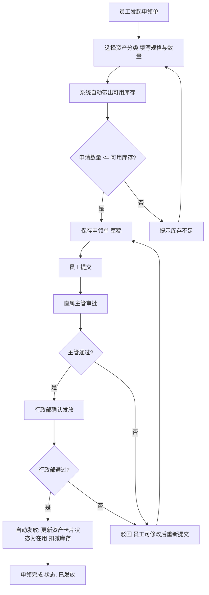

# 需求规格说明书 (Requirements Spec)

> **需求设计层正式交付物**：完整承载 产品概述 + 需求设计（业务对象/字段/规则/安全/配置）+ 界面原型（按需内嵌）。

---

## 文档信息

> **名称**: `固定资产申领` | **版本**: `1.0.0` | **产品经理**: `行政部`
> **创建日期**: `2026-09-17` | **更新日期**: `2026-09-17` | **状态**: 草稿
> **需求简码**: `REQ-fa-001` | **场景类型**: `Create`
> **涉及应用**: `fa` `<!-- 固定资产应用 -->`

---

## 1. 产品概述

### 1.1 产品背景与痛点

公司固定资产（笔记本、显示器、办公桌椅等）的申领仍依赖纸质或邮件审批，存在以下痛点：

1. **无记录追踪**：纸质/邮件申领无系统留痕，申领记录难以追溯，资产去向不透明。
2. **库存数据滞后**：资产发放与台账更新脱节，行政部无法实时掌握可用库存，存在超发或重复申领风险。
3. **审批效率低**：线下审批流转慢，员工无法查看申领进度，需反复询问行政部。

### 1.2 产品价值主张

1. **流程数字化**：将资产申领全流程搬至线上，从发起到发放全程系统留痕，记录可追溯。
2. **库存实时透明**：申领时自动带出可用库存，发放后自动更新资产卡片状态，消除库存数据滞后。
3. **审批透明高效**：标准审批流（直属主管→行政部），员工可自助查询申领记录与当前状态，减少沟通成本。

### 1.3 功能范围

| 功能模块 | 说明 | 优先级 | 变更类型 |
| ----------- | ---------- | ------ | ------------ |
| 资产申领单录入 | 员工在线发起申领单，选择资产分类、规格、数量 | P0 | 🆕 |
| 可用库存自动带出 | 选择资产分类后自动查询可用库存并显示 | P0 | 🆕 |
| 库存校验 | 申请数量超过可用库存时提示"库存不足" | P0 | 🆕 |
| 审批流程 | 员工提交 → 直属主管审批 → 行政部确认发放 | P0 | 🆕 |
| 自动发放与台账更新 | 发放后自动更新资产卡片状态为"在用"，扣减库存 | P0 | 🆕 |
| 申领记录查询 | 员工查询个人申领记录及当前状态 | P1 | 🆕 |

### 1.4 目标用户

| 角色 | 描述 | 业务目标 |
| ----------- | ---------- | ---------- |
| 普通员工 | 需要申领固定资产的员工 | 在线发起申领、查看进度与结果 |
| 直属主管 | 员工的直属上级 | 审批下属的资产申领请求 |
| 行政部专员 | 负责资产发放与台账管理 | 确认发放、维护库存数据准确性 |

---

## 2. 核心摘要 (Summary)

在固定资产应用（fa）中新建**资产申领单**（fa_requisition），支持员工按资产分类发起申领、系统自动带出可用库存并校验、三级审批流（直属主管→行政部）确认后自动发放：将资产卡片状态从"新增/闲置"更新为"在用"并更新使用部门，实现申领全流程数字化追踪与库存实时准确。

---

## 3. 业务流程 (Business Process)



---

## 4. 用户故事 (User Stories)

### 4.1 用户故事 1：US-001 · 资产申领单录入与全流程审批

#### 4.1.1 基本信息

| 字段 | 值 |
| ------------------ | ---------------------- |
| **故事ID** | US-001 |
| **故事名称** | 资产申领单录入与全流程审批 |
| **用户角色** | 普通员工 / 直属主管 / 行政部专员 |
| **优先级** | ☑ P0 |
| **场景类型** | `Create` |

**故事描述**：

> 作为 **普通员工**，我想要可以 **在线发起资产申领单并自动查看可用库存**，以便于 **快速完成申领并了解库存情况**。
> 作为 **直属主管**，我想要可以 **审批下属的资产申领请求**，以便于 **控制部门资产申领合理性**。
> 作为 **行政部专员**，我想要可以 **确认发放并自动更新资产台账**，以便于 **保持库存数据实时准确**。

#### 4.1.2 业务对象

> 状态说明：`Create` = 需新建 · `Patch` = 需修改 · `Existing` = 仅引用
> **角色说明**：仅首行为主业务对象（建模对象），字段/原型/AC 只对它展开；其余实体不参与建模。

| 属性 | 值 | 角色 | 状态 |
| -------- | -------------------------------- | ------------------- | --------------------------------- |
| 实体编码 | `fa_requisition` | **主业务对象（建模对象）** | `Create` |
| 实体编码 | `fa_card` | 关联基础资料（主对象引用的主数据，发放时更新其状态） | `Existing` |
| 实体编码 | `fa_category` | 关联基础资料（主对象引用的主数据） | `Existing` |
| 实体编码 | `bos_user` | 关联基础资料（申领人、发放人引用） | `Existing` |
| 实体编码 | `bos_org` | 关联基础资料（申领部门引用） | `Existing` |
| 实体名称 | 资产申领单 | | |
| 实体类型 | 单据 | | |
| 应用编码 | `fa` | | `Create` |
| 应用名称 | 固定资产应用 | | |
| 描述 | 记录员工固定资产申领请求及审批发放全过程，发放后联动更新资产卡片状态 | | |

#### 4.1.3 用户界面

- **终端要求**：☑ PC端 ☐ 移动端

**字段列表（单据头）**：

| # | 显示名 | 字段类型 | 必填 | 默认值 | 引用来源 | 修改状态 | 说明 |
| - | ---------- | ---------- | :--: | ---------- | -------------------- | ------------ | ---------- |
| 1 | 申领日期 | DateField | ✓ | 当天日期 | — | 🆕 | 业务发生日期 |
| 2 | 申领人 | UserField | ✓ | 当前登录用户 | bos_user | 🆕 | 发起申领的员工 |
| 3 | 申领部门 | OrgField | ✓ | 申领人所属部门 | bos_org | 🆕 | 申领人所在行政组织 |
| 4 | 申领事由 | TextAreaField | - | — | — | 🆕 | 员工填写申领原因 |
| 5 | 发放人 | UserField | - | — | bos_user | 🆕 | 行政部确认发放时自动填充当前操作人 |
| 6 | 发放日期 | DateField | - | — | — | 🆕 | 发放时自动填充当天日期 |

> 系统自动注入字段（申领单号 BillNoField、单据状态 BillStatusField、创建人/创建时间/修改人/修改时间）由平台自动生成，禁止手动创建。

**字段列表（分录明细）**：

| # | 显示名 | 字段类型 | 必填 | 默认值 | 引用来源 | 修改状态 | 说明 |
| - | ---------- | ---------- | :--: | ---------- | -------------------- | ------------ | ---------- |
| 1 | 资产分类 | BasedataField | ✓ | — | basedataNumber=`fa_category` | 🆕 | F7选择资产分类树 |
| 2 | 规格型号 | TextField | - | — | — | 🆕 | 员工填写期望规格，如"ThinkPad T14 16GB" |
| 3 | 申请数量 | IntegerField | ✓ | 1 | — | 🆕 | 必须为正整数 |
| 4 | 可用库存 | IntegerField | - | 0 | — | 🆕 | 只读，选择分类后自动带出（查询 fa_card 中该分类状态为"新增/闲置"的数量） |
| 5 | 备注 | TextField | - | — | — | 🆕 | 分录行补充说明 |

**操作按钮**：

| 按钮 | 操作代码 | 点击前校验 | 点击后行为 | 成功提示 | 失败提示 | 修改状态 |
| ------------ | ---------- | --------------------- | --------------- | ---------- | ---------- | ------------ |
| 保存 | `save` | VAL-REQ-001~003 | 保存为草稿状态 | 保存成功 | 保存失败 | 🆕 |
| 提交 | `submit` | VAL-REQ-001~005, VAL-RNG-001 | 提交至审批流，状态变更为"已提交" | 提交成功 | 提交失败 | 🆕 |
| 撤销 | `unsubmit` | 仅"已提交"状态可撤销 | 退回草稿状态 | 撤销成功 | 撤销失败 | 🆕 |
| 删除 | `delete` | 仅"草稿"状态可删除 | 删除当前单据 | 删除成功 | 删除失败 | 🆕 |
| 发放 | `distribute` | VAL-REQ-006（可用资产充足） | 自动分配资产卡片、更新卡片状态为"在用"、更新使用部门，状态变更为"已发放" | 发放成功，已分配 N 件资产 | 发放失败：可用资产不足 | 🆕 |

> "发放"操作在审批流终点（行政部确认通过后）由系统自动触发执行，也可由行政部专员手动点击确认。

**界面原型**：

```
┌─────────────────────────────────────────────────────────────────────┐
│ 资产申领单                                          [保存] [提交] ... │
├─────────────────────────────────────────────────────────────────────┤
│ ┌──────────────────── 基本信息 ────────────────────┐                │
│ │  申领单号: [自动生成]        单据状态: [🟢 草稿]  │                │
│ │  申领日期: [📅 2026-09-17]   申领人:  [当前用户]  │                │
│ │  申领部门: [当前部门]        申领事由: [________] │                │
│ │  发放人:  [__________]      发放日期: [📅 ____]   │                │
│ └──────────────────────────────────────────────────┘                │
│                                                                      │
│ ┌──────────────────── 资产申领明细 ────────────────┐                │
│ │  [增行] [删行]                                    │                │
│ │ ┌───┬──────────────┬───────────┬──────┬──────┬───┐│                │
│ │ │ # │ 资产分类     │ 规格型号   │申请数量│可用库存│备注││            │
│ │ ├───┼──────────────┼───────────┼──────┼──────┼───┤│                │
│ │ │ 1 │[▼ 请选择]    │[________] │[   1]│[   0]│[_] ││                │
│ │ │ 2 │[▼ 请选择]    │[________] │[   1]│[   0]│[_] ││                │
│ │ └───┴──────────────┴───────────┴──────┴──────┴───┘│                │
│ └──────────────────────────────────────────────────┘                │
│                                                                      │
│                  [保存] [提交] [撤销] [删除] [发放]                  │
└─────────────────────────────────────────────────────────────────────┘
```

> 控件映射：TextField `[__________]`、DateField `[📅 yyyy-mm-dd]`、IntegerField `[   0]`、BasedataField `[▼ 请选择]`、BillNoField `[自动生成]`、BillStatusField `[🟢 状态]`。

#### 4.1.x 列表逻辑（List Model）

**查询字段（搜索区）**：

| # | 查询字段 | 控件 | 说明 |
|---|---------|------|------|
| 1 | 申领单号 | 文本框 | 精确查询 |
| 2 | 申领人 | 文本框 | 模糊查询 |
| 3 | 申领部门 | 下拉 | 精确查询 |
| 4 | 申领日期 | 日期范围 | 起始-结束范围查询 |
| 5 | 单据状态 | 下拉 | 精确查询（草稿/已提交/审批中/已发放/已驳回） |

**过滤字段（列表过滤）**：

| # | 过滤字段 | 过滤方式 | 说明 |
|---|---------|---------|------|
| 1 | 申领人 | 精确（当前用户） | 普通员工仅查看自己的申领记录；行政部可查看全部 |

**排序字段**：

| # | 排序字段 | 规则 |
|---|---------|------|
| 1 | 申领日期 | 降序 |
| 2 | 申领单号 | 降序 |

**字段列表（显示列）**：

| # | 列字段 | 列类型 | 说明 |
|---|--------|--------|------|
| 1 | 申领单号 | 文本 | 系统自动生成 |
| 2 | 申领日期 | 日期 | — |
| 3 | 申领人 | 文本 | — |
| 4 | 申领部门 | 文本 | — |
| 5 | 单据状态 | 枚举 | 草稿/已提交/审批中/已发放/已驳回 |
| 6 | 申领明细摘要 | 文本 | 汇总显示分类+数量，如"笔记本×2, 显示器×1" |

**列表后端业务逻辑**：

| # | 逻辑 | 触发时机 | 说明 |
|---|------|---------|------|
| 1 | 行级数据权限 | 加载 | 普通员工仅可见本人申领记录；行政部专员可见全部记录 |

#### 4.1.4 业务规则

**校验规则**：

| 规则编码 | 应用字段/场景 | 触发时机 | 具体配置 | 错误提示 |
| --------- | --------------- | ---------- | ---------- | -------- |
| `VAL-REQ-001` | 申领人 | 保存/提交 | 申领人不能为空 | 请选择申领人 |
| `VAL-REQ-002` | 申领部门 | 保存/提交 | 申领部门不能为空 | 请选择申领部门 |
| `VAL-REQ-003` | 分录 | 保存/提交 | 分录至少一行 | 请至少添加一条申领明细 |
| `VAL-REQ-004` | 分录.资产分类 | 保存/提交 | 每行资产分类不能为空 | 请选择资产分类 |
| `VAL-REQ-005` | 分录.申请数量 | 保存/提交 | 申请数量不能为空且必须为正整数 | 申请数量必须为正整数 |
| `VAL-RNG-001` | 分录.申请数量 vs 可用库存 | 提交 | 申请数量不得超过可用库存 | 库存不足：当前可用 {可用库存} 件，申请 {申请数量} 件 |
| `VAL-REQ-006` | 发放操作 | 发放 | 每行对应资产分类的可用资产卡片数量 >= 申请数量 | 发放失败：{资产分类} 可用资产不足，需 {申请数量} 件，实际可用 {实际可用} 件 |

**计算规则**：

| 规则编码 | 触发字段 | 触发时机 | 计算目标 | 计算公式 |
| --------- | ---------- | ---------- | ---------- | -------- |
| `CAL-QTY-001` | 分录.资产分类 | 资产分类值变更 | 分录.可用库存 | 查询 fa_card 中 categoryId = 当前行资产分类 AND status IN ('新增','闲置') 的记录数 |

**联动规则**：

| 规则编码 | 触发字段 | 触发时机 | 联动行为 | 说明 |
| --------- | ---------- | ---------- | ---------- | ---- |
| `LNK-FLD-001` | 分录.资产分类 | 值变更 | 自动填充分录.可用库存 | 触发 CAL-QTY-001 计算并回填 |
| `LNK-FLD-002` | 发放操作 | 发放执行后 | 自动填充单据头.发放人、发放日期 | 发放人=当前操作人，发放日期=当天 |
| `LNK-STS-001` | 发放操作 | 发放执行后 | 更新 fa_card 状态 | 将分配的资产卡片 status 从"新增/闲置"变更为"在用"，orgId 更新为申领部门 |
| `LNK-STS-002` | 发放操作 | 发放执行后 | 更新 fa_requisition 状态 | 单据状态变更为"已发放" |

**控制规则**：

| 规则编码 | 控制对象 | 触发时机 | 控制条件 | 控制效果 |
| --------- | ---------- | ---------- | ---------- | -------- |
| `CTL-EDT-001` | 单据头.申领人/申领部门/申领事由 + 分录全部字段 | 状态变更 | 单据状态 ≠ '草稿' | 锁定不可编辑 |
| `CTL-EDT-002` | 单据全部字段 | 状态变更 | 单据状态 = '已发放' | 整单锁定不可编辑 |
| `CTL-VIS-001` | 单据头.发放人/发放日期 | 状态变更 | 单据状态 = '已发放' | 显示发放人/发放日期字段 |
| `CTL-VIS-002` | 单据头.发放人/发放日期 | 状态变更 | 单据状态 ≠ '已发放' | 隐藏发放人/发放日期字段 |

**其他规则**：

| 规则编号 | 规则名称 | 规则描述 | 触发时机 | 处理逻辑 |
| -------- | ---------- | ---------- | ---------- | -------------- |
| `BIZ-001` | 资产自动分配 | 发放时为每行分录从可用资产卡片池中分配对应数量的资产 | 发放操作执行时 | 遍历分录每行：查询 fa_card WHERE categoryId=该行资产分类 AND status IN('新增','闲置') ORDER BY purchaseDate ASC LIMIT 该行申请数量；更新选中卡片的 status='在用'、orgId=申领部门。若可用数量不足则中断发放并回滚已分配的卡片 |
| `BIZ-002` | 库存实时校验 | 提交时重新校验可用库存，防止提交至发放期间库存被其他申领占用 | 提交操作执行前 | 对每行分录重新执行 CAL-QTY-001 计算最新可用库存，若申请数量 > 最新可用库存则阻止提交 |

**场景验证**：

| # | 场景类型 | 场景描述 | 触发条件 | 预期结果 |
| - | -------- | ---------- | ---------- | ---------- |
| 1 | 正常 | 员工选择资产分类后查看可用库存 | 选择资产分类"电子设备-笔记本"，该分类下有 5 件"新增"状态资产 | 可用库存自动显示为 5 |
| 2 | 正常 | 员工填写 2 件并提交 | 申请数量 2 <= 可用库存 5 | 提交成功，进入审批流 |
| 3 | 正常 | 直属主管审批通过 | 主管在审批节点点击通过 | 流转至行政部确认节点 |
| 4 | 正常 | 行政部确认发放 | 行政部在终审节点通过 | 系统自动分配 2 件资产卡片，卡片状态变更为"在用"，申领单状态变为"已发放" |
| 5 | 正常 | 员工查询申领记录 | 员工打开申领记录列表 | 显示本人所有申领单及当前状态 |
| 50 | 边界 | 申请数量等于可用库存 | 可用库存 3，申请数量 3 | 校验通过，可提交 |
| 51 | 边界 | 分录为空时提交 | 未添加任何明细行 | 提示"请至少添加一条申领明细"，阻止提交 |
| 52 | 边界 | 同一分类多行申领 | 分录有两行同为"笔记本"分类，分别申请 2 件和 3 件，可用库存 4 件 | 第二行可用库存实时更新为 2（5-2-1=2，已分配预占），提示库存不足 |
| 80 | 异常 | 申请数量超过可用库存 | 可用库存 3，申请数量 5 | 提示"库存不足：当前可用 3 件，申请 5 件"，阻止提交 |
| 81 | 异常 | 发放时可用资产已被其他申领占用 | 提交时可用 3 件，发放时仅剩 1 件 | 提示"发放失败：可用资产不足，需 3 件，实际可用 1 件"，中断发放 |
| 82 | 异常 | 无权限用户访问 | 非行政部员工尝试查看全部申领记录 | 仅显示本人记录，无法查看他人数据 |

#### 4.1.5 安全

**敏感数据脱敏**：

| # | 敏感字段 | 脱敏规则 | 修改状态 |
| - | ---------- | ---------- | -------- |
| — | 无 | 本单据不涉及敏感个人隐私数据 | — |

**重要数据加密**：

| # | 加密字段 | 加密方式 | 修改状态 |
| - | ---------- | --------------------- | -------- |
| — | 无 | 本单据不涉及需加密的重要数据 | — |

**权限项**：

| # | 权限对象 | 权限项 | 绑定操作 | 修改状态 |
| - | ---------- | ---------------- | -------------- | -------- |
| 1 | fa_requisition | PERM-FA-REQUISITION-VIEW | view | 🆕 |
| 2 | fa_requisition | PERM-FA-REQUISITION-CREATE | save | 🆕 |
| 3 | fa_requisition | PERM-FA-REQUISITION-EDIT | save | 🆕 |
| 4 | fa_requisition | PERM-FA-REQUISITION-DELETE | delete | 🆕 |
| 5 | fa_requisition | PERM-FA-REQUISITION-SUBMIT | submit | 🆕 |
| 6 | fa_requisition | PERM-FA-REQUISITION-DISTRIBUTE | distribute | 🆕 |

**审计日志**：

| # | 操作代码 | 操作日志 | 审计日志 | 修改状态 |
| - | ---------- | :---------: | :---------: | -------- |
| 1 | save | ☑ 是 | ☐ 否 | 🆕 |
| 2 | submit | ☑ 是 | ☑ 是 | 🆕 |
| 3 | distribute | ☑ 是 | ☑ 是 | 🆕 |
| 4 | delete | ☑ 是 | ☑ 是 | 🆕 |

#### 4.1.6 关联配置

| 配置项 | 是否支持 | 修改状态 | 说明 |
| -------- | :---------: | -------- | ------------------- |
| 打印配置 | ☑ 是 | 🆕 | 支持申领单打印模板 |
| 导入导出 | ☑ 是 | 🆕 | 支持申领记录 Excel 导出 |
| 预警方案 | ☐ 否 | 🆕 | 无预警需求 |
| BOTP配置 | ☐ 否 | 🆕 | 无单据转换需求 |
| 流程配置 | ☑ 是 | 🆕 | 三级审批流：员工提交 → 直属主管审批 → 行政部确认发放 |

#### 4.1.7 关联依赖

**引用对象**：

| # | 依赖来源 | 类型 | 被调用内容 | 说明 |
| - | ---------- | ---- | --------------- | ------------------ |
| 1 | fa-cloud/fa | 引用 | fa_category（资产分类） | 分录.资产分类字段引用，F7 选择资产分类树 |
| 2 | fa-cloud/fa | 引用 | fa_card（资产卡片） | 可用库存计算（查询 status=新增/闲置 的卡片数量）；发放时更新卡片状态与使用部门 |
| 3 | base-cloud/base | 引用 | bos_user（人员） | 申领人、发放人字段引用 |
| 4 | base-cloud/base | 引用 | bos_org（组织） | 申领部门字段引用 |

**后续影响**：

| # | 影响对象 | 类型 | 主动调用内容 | 说明 |
| - | ------------------ | ------ | ------------ | ------------------ |
| 1 | fa-cloud/fa/fa_card | 被引用 | 发放操作更新资产卡片 status 和 orgId | fa_card 被 fa_requisition 的发放操作联动更新 |

#### 4.1.8 关联影响分析

> Create 场景：新建业务对象，无历史影响，不适用。

**本单据影响**：

| 修改内容 | 影响类型 | 影响描述 | 处理方案 |
| -------------- | -------------------------------------------------------- | -------------- | -------------- |
| 新建实体 fa_requisition | — | Create 无历史影响，不适用 | — |

**外部单据影响**：

| 修改内容 | 影响单据 | 影响类型 | 影响描述 | 处理方案 |
| ---------- | ------------ | --------------------------------------------------------------- | -------------- | -------------- |
| 新建实体 fa_requisition | — | — | Create 无历史影响，不适用 | — |

#### 4.1.9 验收标准 (AC)

- [ ] **AC-US001-01**：当员工新建申领单并选择资产分类"电子设备-笔记本"时，系统自动查询 fa_card 中该分类下状态为"新增"或"闲置"的记录数，将数量填入"可用库存"字段。
- [ ] **AC-US001-02**：当员工填写申请数量为 5，而可用库存为 3 时，点击提交系统提示"库存不足：当前可用 3 件，申请 5 件"，阻止提交。
- [ ] **AC-US001-03**：当员工填写完整的申领单（申领人、申领部门、至少一条分录明细、每行有资产分类和正整数申请数量）后点击保存，系统生成申领单号并保存为"草稿"状态。
- [ ] **AC-US001-04**：当员工点击提交时，系统对每行分录重新计算最新可用库存，若全部通过校验则状态变更为"已提交"并进入审批流；否则提示库存不足并阻止提交。
- [ ] **AC-US001-05**：当直属主管在审批节点点击通过后，申领单流转至行政部确认节点；若点击驳回，状态变更为"已驳回"，员工可修改后重新提交。
- [ ] **AC-US001-06**：当行政部在终审节点确认发放后，系统自动为每行分录分配对应数量的 fa_card（状态从"新增/闲置"变更为"在用"，使用部门更新为申领部门），申领单状态变更为"已发放"，自动填充发放人与发放日期。
- [ ] **AC-US001-07**：当发放时某分类可用资产卡片数量不足（已被其他申领占用），系统提示"发放失败：{分类} 可用资产不足"，中断发放并回滚已分配的卡片。
- [ ] **AC-US001-08**：当员工打开申领记录列表时，仅显示本人发起的申领单，可按申领单号、日期、状态查询，列表按申领日期降序排列。
- [ ] **AC-US001-09**：当单据状态为"已提交"及之后状态时，申领人、申领部门、申领事由和分录全部字段锁定不可编辑。
- [ ] **AC-US001-10**：当单据状态为"已发放"时，整单锁定，发放人/发放日期字段显示。

---

## 5. 业务需求

### 5.1 功能性需求

| ID | 需求描述 | 优先级 | 变更类型 | 对应故事 |
| ---------------- | ------------------------------------------------------- | ------ | -------- | -------- |
| **FR-001** | 普通员工**必须能够**在线发起资产申领单，选择资产分类、填写规格型号和申请数量 | P0 | 🆕 | US-001 |
| **FR-002** | 系统**必须**在员工选择资产分类后自动查询 fa_card 中该分类"新增/闲置"状态的资产数量并回填至"可用库存"字段 | P0 | 🆕 | US-001 |
| **FR-003** | 系统**必须**在申请数量超过可用库存时提示"库存不足"并阻止提交 | P0 | 🆕 | US-001 |
| **FR-004** | 系统**必须**支持三级审批流：员工提交 → 直属主管审批 → 行政部确认发放 | P0 | 🆕 | US-001 |
| **FR-005** | 系统**必须**在行政部确认发放后自动分配资产卡片：将对应数量的 fa_card 状态从"新增/闲置"更新为"在用"，使用部门更新为申领部门 | P0 | 🆕 | US-001 |
| **FR-006** | 系统**必须**在发放后自动填充发放人与发放日期，并将申领单状态变更为"已发放" | P0 | 🆕 | US-001 |
| **FR-007** | 普通员工**必须能够**查询个人申领记录及当前状态 | P1 | 🆕 | US-001 |
| **FR-008** | 系统**必须**在提交时重新校验最新可用库存，防止并发申领导致超发 | P1 | 🆕 | US-001 |

### 5.2 非功能性需求

#### 性能要求

- 可用库存查询响应：`<= 2秒`（单次资产分类变更触发 fa_card 聚合查询）
- 申领单保存响应：`<= 3秒`（分录 ≤ 50 行）
- 列表查询响应：`<= 2秒`（1000 条申领记录）

#### 准确性要求

- 可用库存数量**100%**准确（实时查询 fa_card，不使用缓存）
- 资产发放数量**100%**准确（发放数量 = 申请数量，分配卡片数量精确匹配）

#### 安全与隐私

- 系统必须支持基于角色的访问控制（RBAC），普通员工仅可查看本人申领记录
- 发放操作（distribute）需行政部专员权限，记录审计日志
- 提交和删除操作记录操作日志和审计日志
- 数据访问必须遵循租户隔离原则

#### 可用性

- 系统可用性 >= 99.9%

---

## 6. 成功标准

| ID | 成功指标 | 目标值 | 衡量方式 | 优先级 |
| ---------------- | ---------- | ---------- | ---------- | ------ |
| **SC-001** | 申领审批周期 | ≤ 4小时（工作时间） | 从提交到发放的平均时长，系统日志统计 | P0 |
| **SC-002** | 库存数据准确率 | 100% | fa_requisition 发放记录与 fa_card 状态变更记录对账 | P0 |
| **SC-003** | 资产发放自动化率 | ≥ 90% | 发放操作中无需人工干预分配资产的比例 | P0 |
| **SC-004** | 申领记录可追溯率 | 100% | 所有已发放申领单可通过申领单号追溯至资产卡片 | P1 |

---

## 7. 假设条件

- 资产卡片（fa_card）的"新增"和"闲置"状态资产视为可用库存来源，其他状态（在用/维修中/已报废/已处置）不计入可用库存。
- 发放时按先进先出（purchaseDate 升序）原则从可用资产卡片池中分配。
- 同一申领单分录中若存在多行相同资产分类，各行可用库存独立计算，但实际发放时共享同一卡片池（BIZ-001 逐行分配时需扣减已分配数量）。
- 直属主管通过苍穹组织模型（bos_org）自动推导，无需申领人手动选择。
- 审批流使用苍穹标准工作流引擎配置，无需开发自定义审批组件。

---

## 8. 问题记录与澄清

**问题记录**：

| # | 问题描述 | 影响 | 负责人 | 状态 |
| - | ---------- | ---------- | -------- | ---------- |
| P-001 | 同一申领单多行相同分类的库存预占逻辑：当前设计为各行独立显示可用库存，但提交时需考虑多行共用同一卡片池的总量校验（见 BIZ-002），实际可用库存应 = 该分类总可用量 - 同单已申请量。已在场景验证 #52 覆盖，实施时需确认 CAL-QTY-001 计算逻辑是否需调整为同单内预占扣减 | 配置级（计算规则细节） | 行政部 / 开发 | 待确认 |
| P-002 | "规格型号"字段为自由文本，不参与可用库存查询过滤。若需按规格精确匹配库存，需在 fa_card 中增加规格字段或通过 assetName 匹配，当前设计由行政部在发放时人工匹配 | 配置级（字段设计细节） | 行政部 | 待确认 |
| P-003 | 直属主管自动推导依赖苍穹组织模型中"直属上级"关系配置。若组织模型中未维护上下级关系，审批流需调整为手动选择审批人 | 结构级（审批流配置依赖） | 行政部 / IT | 待确认 |

**问题澄清**：

### 评审会议 2026-09-17

- 问：D4 可用库存数据来源？ 答：来源于资产卡片（fa_card），按资产分类汇总"新增"和"闲置"状态的资产数量作为可用库存；发放时将对应资产卡片状态改为"在用"并更新使用部门。

---

## 9. 变更历史

| 版本 | 日期 | PM | 变更描述 |
| ----- | ---------- | -------- | -------- |
| 1.0.0 | 2026-09-17 | 行政部 | 初始版本：新建资产申领单（fa_requisition），含录入、库存校验、三级审批流、自动发放与台账更新 |
